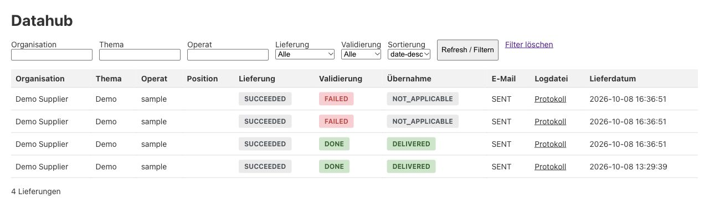
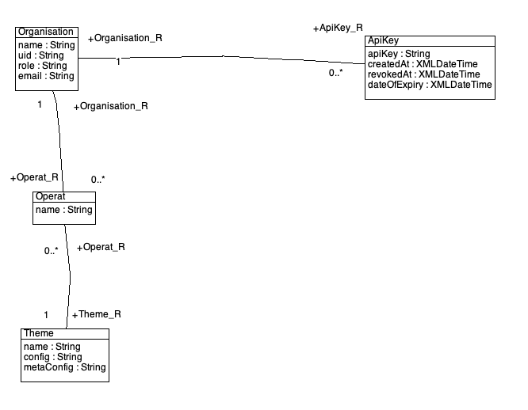

# Benutzerhandbuch

Datahub nimmt INTERLIS-Transferdateien über eine REST-API entgegen. Ein API-Key besteht aus zwei
UUIDs im Format `keyId.secret`, beispielsweise
`11111111-1111-1111-1111-111111111111.22222222-2222-2222-2222-222222222222`.
Die Organisation des Keys bestimmt, welche Operate (`operat`) eines Themas (`theme`) sie liefern darf.
Die folgenden Keys, Namen und Zeitangaben sind Beispiele.

## Daten anliefern

Das Beispiel liefert das Operat `2471` des Themas `IPW_2020`. Der Dateiname ist frei wählbar;
die Transferdatei darf nicht gezippt sein. `file`, `theme` und `operat` müssen jeweils genau einmal
als Multipart-Feld vorkommen. Zusätzliche Query-Werte für Thema und Operat dürfen den
Multipart-Werten nicht widersprechen und nicht mehrfach vorkommen.

```sh
curl -i -H 'X-API-KEY: 11111111-1111-1111-1111-111111111111.22222222-2222-2222-2222-222222222222' \
  -F file=@2471_gep.xtf -F theme=IPW_2020 -F operat=2471 \
  https://geo.so.ch/datahub/api/deliveries
```

**HTTPS verwenden:** Wird ein Request als HTTP erkannt, widerruft der Server den verwendeten
gültigen Key, sofern der Host nicht ausdrücklich auf der HTTP-Whitelist steht. Die lokale
Entwicklungsumgebung verwendet diese Ausnahme für `localhost`.

Eine erfolgreiche Annahme liefert eine leere Antwort mit `202 Accepted` und einem Statuslink:

```http
HTTP/1.1 202 Accepted
Operation-Location: https://geo.so.ch/datahub/api/jobs/e6083332-857e-4f98-82d7-c15f458286ce
```

Zu diesem Zeitpunkt sind die Eingabedatei, die Lieferung und ihr erster Prüfversuch dauerhaft
gespeichert. Die Übergabe an JobRunr erfolgt anschliessend; die Antwort bestätigt weder eine
Validierung noch eine Veröffentlichung. Jeder neue POST erzeugt eine neue Lieferung.

## Status, Übersicht und Protokoll

Die URL aus `Operation-Location` ist ohne Anmeldung abrufbar. Die öffentliche `jobId` ist die
stabile ID der Lieferung. Jeder Prüfversuch hat eine eigene UUID, die JobRunr als technische Job-ID
verwendet. Eine mögliche
Antwort nach erfolgreicher Verarbeitung ist:

```json
{
  "jobId": "e6083332-857e-4f98-82d7-c15f458286ce",
  "createdAt": "2026-10-09T09:00:00",
  "updatedAt": "2026-10-09T09:00:20",
  "status": "SUCCEEDED",
  "operat": "2471",
  "theme": "IPW_2020",
  "organisation": "ACME GmbH",
  "validationStatus": "DONE",
  "logFileLocation": "https://geo.so.ch/datahub/api/logs/e6083332-857e-4f98-82d7-c15f458286ce",
  "deliveryStatus": "DELIVERED",
  "notificationStatus": "SENT"
}
```

Die vier Ergebnisfelder beantworten unterschiedliche Fragen:

| Feld | Werte und Bedeutung |
| --- | --- |
| `status` | `ENQUEUED`: wartet; `PROCESSING`: Prüfung läuft; `SUCCEEDED`: Prüfung technisch abgeschlossen; `FAILED`: technischer Fehler |
| `validationStatus` | `DONE`: gültig; `FAILED`: ungültig. Vor der Prüfung oder ohne abschliessendes Prüfergebnis fehlt das Feld. |
| `deliveryStatus` | `WAITING`: wartet auf Prüfung; `PENDING`: Übernahme ausstehend; `RETRY`: erneuter Übernahmeversuch vorgesehen; `DELIVERED`: veröffentlicht; `SUPERSEDED`: neuerer gültiger Stand bereits veröffentlicht; `FAILED`: Übernahme endgültig fehlgeschlagen; `NOT_APPLICABLE`: keine Übernahme, etwa bei ungültigen Daten |
| `notificationStatus` | `WAITING`: wartet auf Verarbeitung; `PENDING`: Mailauftrag bereit; `RETRY`: Versand wird wiederholt; `SENT`: SMTP hat die Mail angenommen; `FAILED`: Versand endgültig fehlgeschlagen; `DISABLED`: Mailversand war bei Annahme deaktiviert |

`SUCCEEDED` kann mit `validationStatus=FAILED` auftreten: Die Prüfung lief erfolgreich, die Datei
ist aber ungültig. Ebenso kann eine gültige Datei mit `deliveryStatus=FAILED` einen Übernahmefehler
haben. Ein Mailfehler verändert das Validierungsergebnis nicht. `SENT` bestätigt die SMTP-Annahme,
nicht das Lesen der Nachricht durch den Empfänger.

Bei wartenden Lieferungen enthält `queuePosition` die Position in der Warteschlange.
`logFileLocation` verweist nach Abschluss auf das Prüfprotokoll. Übernommene Altinformationen können
zusätzlich historische Ausführungszustände wie `DELETED` oder `UNKNOWN` sowie `LEGACY` für Übernahme
und Benachrichtigung enthalten. Sie sind kein Nachweis einer neuen Prüfung. Das spätere Löschen
eines technischen Jobs verändert die gespeicherte Lieferhistorie nicht.

Die öffentliche [Übersicht](https://geo.so.ch/datahub/jobs) zeigt die Lieferungen der letzten
vierzehn Tage. Organisation, Thema, Operat, Ausführung und Validierung sind filterbar. Filter und
Sortierung stehen in der URL; standardmässig erscheinen 25 Zeilen mit den neuesten Lieferungen
zuerst. Die bisherige Adresse `/web/jobs.xhtml` leitet auf `/jobs` weiter.



Die REST-Liste `/api/jobs` verwendet weiterhin das konfigurierte Standardlimit von 300 Lieferungen
innerhalb der vierzehn Tage. Eine leere Liste oder eine unbekannte ID bei `/api/jobs/{jobId}` liefert
`204 No Content`. Einzelne bekannte Lieferungen bleiben auch ausserhalb des Listenzeitraums abrufbar.

Öffentliche Prüfprotokolle sind standardmässig drei Tage ab dem gespeicherten Abschluss verfügbar.
Dieser Abschluss wird durch die Prüfung und anschliessende Übernahme bestimmt; ein späterer
Mailversand verlängert die Frist nicht. Danach liefert `/api/logs/{jobId}` `410 Gone`. Für unbekannte
Lieferungen oder noch nicht vorhandene Protokolle lautet die Antwort `404 Not Found`.
Liefermetadaten bleiben erhalten. Die Bereinigungsregeln stehen im [Betriebshandbuch](admin-manual-de.md).

Bei aktiviertem Mailversand wird nach Abschluss von Prüfung und Übernahme ein Ergebnis-Mailauftrag
angelegt. Der Betreff enthält Validierungsstatus, Operat und Thema. Veröffentlichung und Versand
werden bei Fehlern unabhängig voneinander höchstens dreimal nach 1, 5 und 15 Minuten wiederholt;
dadurch wird keine neue Validierung ausgelöst.

### Abgelehnte Anlieferungen

Abgelehnte Requests erzeugen keine Lieferung. Datenbank- und Speicherfehler werden als technische
Fehler behandelt. Die bestehenden Authentifizierungsantworten bleiben wie folgt:

| Situation | HTTP-Status | Beispiel für `message` |
| --- | --- | --- |
| API-Key-Header fehlt | `401` | `Did not find api key header in request.` |
| Key falsch, widerrufen oder abgelaufen | `403` | `Forbidden.` |
| Organisation für Thema/Operat nicht berechtigt oder Ziel unbekannt | `403` | `User is not authorized` |
| Doppelte Multipart-Felder | `400` | `Duplicate or missing multipart field: theme` |
| Widersprechende oder mehrfache fachliche Query-Werte | `400` | `Conflicting delivery parameters` |
| Leere Transferdatei | `400` | `Empty transfer file` |
| Erwartete Transfermodelle des Themas fehlen | `503` | `Theme requires expected transfer models.` |
| Uploadannahme pausiert | `503` | `Delivery acceptance paused` |

Ein fehlendes Pflichtfeld wird ebenfalls mit `400` abgelehnt; die genaue Fehlermeldung hängt davon
ab, ob bereits Spring die Multipart-Bindung ablehnt. Fehler enthalten `code`, `message`,
`timestamp` und `path`, gegebenenfalls zusätzlich `details`. `code` benennt die Fehlerklasse,
beispielsweise bei fehlendem Header:

```json
{
  "code": "org.springframework.security.authentication.InsufficientAuthenticationException",
  "message": "Did not find api key header in request.",
  "timestamp": "2026-10-09T07:00:00Z",
  "path": "/datahub/api/deliveries"
}
```

Bei einem unberechtigten Lieferziel lautet `code`
`org.springframework.web.server.ResponseStatusException`; bei ungültigem Key
`org.springframework.security.access.AccessDeniedException`. Der Pfad enthält einen allfälligen
Deployment-Kontext wie `/datahub`; Zeitangaben sind Beispiele.

## API-Keys anfordern und widerrufen

Eine Organisation kann mit einem gültigen eigenen Key weitere Keys für sich selbst anfordern:

```sh
curl -i -X POST \
  -H 'X-API-KEY: 11111111-1111-1111-1111-111111111111.22222222-2222-2222-2222-222222222222' \
  https://geo.so.ch/datahub/api/keys
```

Ein Administrator muss die bereits konfigurierte Zielorganisation angeben. Ohne diese Angabe
antwortet die API mit `500` und `Parameter 'organisation' is required.`; es wird kein Admin-Key
als Ersatz erzeugt:

```sh
curl -i -X POST \
  -H 'X-API-KEY: 11111111-1111-1111-1111-111111111111.22222222-2222-2222-2222-222222222222' \
  -F 'organisation=ACME GmbH' https://geo.so.ch/datahub/api/keys
```

Bei erfolgreicher Ausstellung liefert die API `200` mit folgendem Inhalt:

```json
{
  "message": "Sent email with new api key.",
  "timestamp": "2026-10-09T07:05:00Z"
}
```

Der neue Key steht ausschliesslich in der Mail an die konfigurierte Organisationsadresse.
Zunächst wird sein BCrypt-Hash als `PENDING` gespeichert, nach erfolgreichem Versand wird er
`ACTIVE`. Bei Versand- oder Aktivierungsfehlern bleibt kein verwendbarer neuer Key zurück;
die Antwort lautet `500` mit `Key could not be delivered and activated.`. Die Ausstellung wird
nicht automatisch wiederholt. Bei deaktiviertem Mailversand liefert sie vor dem Speichern `503`
mit `Key issuance requires email delivery.`.

In der Datenbank steht `keyId:hash`, nicht das Secret. Der vollständige Key wird nicht in
gespeicherte Benachrichtigungsaufträge übernommen. Neue Keys haben standardmässig kein Ablaufdatum;
ein administrativ gesetztes Ablaufdatum wird bei der Authentifizierung berücksichtigt.
Organisationsadressen und Ablaufdaten werden administrativ in der Datenbank gepflegt.

Zum Widerrufen bleibt die bestehende DELETE-Route mit dem vollständigen Ziel-Key erhalten:

```sh
curl -i -X DELETE \
  -H 'X-API-KEY: 11111111-1111-1111-1111-111111111111.22222222-2222-2222-2222-222222222222' \
  https://geo.so.ch/datahub/api/keys/33333333-3333-3333-3333-333333333333.44444444-4444-4444-4444-444444444444
```

Der aufrufende Key muss derselben Organisation angehören; dies gilt auch für Administratoren.
Erfolgreicher Widerruf liefert `200` und `API key deleted.`. Ist der Key nicht auffindbar oder
gehört er einer anderen Organisation, bleibt die bestehende Antwort `500` mit
`code=org.springframework.web.server.ResponseStatusException` und `API key not deleted.`.
Der Datensatz bleibt als widerrufen erhalten.

## Endablage und Dateilisten

Nur gültige Ergebnisse werden veröffentlicht. Die normalen Dateien bleiben unter
`Thema/Operat.xtf` und `Thema/Operat.xtf.log` verfügbar. Ein älterer Lieferstand verdrängt keinen
bereits veröffentlichten neueren gültigen Stand. Die beiden Dateien werden jeweils atomar ersetzt;
zwei unabhängige Lesezugriffe erhalten keine zugesicherte gemeinsame Momentaufnahme.

Die externe Tomcat-Dateiliste verwendet die Basic Authentication der jeweiligen Installation.
URL und Zugangsdaten werden vom Betrieb bereitgestellt; es gibt keine hier zugesicherten
Standardzugangsdaten. Die Anwendung besitzt zusätzlich die geschützte Dateiliste `/ui/files`
und die API `/api/files`, die einen API-Key der Admin-Organisation verlangen. Der öffentliche
Status- und Protokollzugriff benötigt weiterhin keinen Key.

## Autorisierung und Themenkonfiguration

Das INTERLIS-Modell `SO_AGI_Datahub_Config_20240403` beschreibt Organisationen, Keys, Themen und
Operate. Die Abbildung zeigt die Beziehungen, nicht sämtliche aktuellen Attribute:



Massgeblich ist das [aktuelle INTERLIS-Modell](../dev/SO_AGI_Datahub_20240403.ili).
Die Admin-Organisation pflegt die Konfiguration direkt in der Datenbank, beispielsweise mit DBeaver.

Pro Thema ist `expectedModels` beziehungsweise `core_theme.expected_models` erforderlich: eine mit
Semikolon getrennte Liste der erwarteten Transfermodelle. Ohne diese Einstellung werden Lieferungen
mit `503` abgelehnt. Tatsächlich enthaltene Transfermodelle werden geprüft; reine
Abhängigkeitsdeklarationen im Header gelten nicht pauschal als fachfremde Inhalte.

`config` und `metaConfig` sind optionale IDs von Konfigurationsdateien im bevorzugten
INTERLIS-Modellrepository. Ihre Werte werden bei der Lieferung für den Prüfversuch festgehalten.
Die fachliche Operatsprüfung erfolgt weiterhin durch die konfigurierten INTERLIS-Regeln.
Details zu Einrichtung und Änderungen stehen im [Betriebshandbuch](admin-manual-de.md).
